# TracePilot

**An AI incident investigator for application errors.** Your app sends error events to TracePilot. It groups them into incidents,
charts how they unfold, and asks an LLM for ranked, evidence-backed root-cause hypotheses where **every claim cites a real stored event** and
is verified before it is shown.

Built as a full-stack engineering portfolio project: Next.js 16 App Router on Vercel, Supabase (Auth + Postgres with Row Level Security),
a typed Node.js SDK, and a test suite that runs the real SQL against a real Postgres.

> **Status, stated plainly.** Everything below runs and is tested locally, including a browser pass of the whole signed-in app against a
> local Supabase *emulator* (real Postgres, real migrations, emulated HTTP layer). It has **not** been deployed, and has **not** been run
> against a real Supabase project or the real Anthropic API. See [PROJECT_STATUS.md](PROJECT_STATUS.md) for exactly what is and is not verified.

## The problem

When an application starts failing, the first hour is spent on the same chore: find the first error, work out whether five hundred alerts are
one problem or five, line errors up against the last deploy, read stack traces, and form a theory. Error trackers group and count; LLM chat
tools theorise but can't be trusted to stay on the evidence. TracePilot combines them under one rule: **the model may only reason about
events that TracePilot retrieved, and any claim that cites an event TracePilot did not give it is rejected.**

## What it does

- **Ingest** events over an authenticated HTTP API (or the SDK): validated, size-limited, rate-limited, idempotent.
- **Group** them into incidents with a deterministic fingerprint, safely under concurrency; recurring resolved incidents reopen.
- **Investigate**: incident timeline (events, status changes, deployments), paginated events, stack traces, and an AI analysis with ranked hypotheses, a persisted checklist of read-only diagnostic steps, and evidence buttons that open the stored event.
- **Monitor**: a dashboard with real SQL-aggregated KPIs, an error-rate chart with deploy markers, severity mix and recent incidents. No invented trends: a comparison appears only when there is real history behind it.
- **Try the demo**: a deterministic, clearly labelled *simulated* outage (bad deploy, HTTP 500 burst plus database timeouts on `/api/checkout`, rollback, recovery) that works with no AI key.

## Screenshots

All screenshots are of the implemented app running locally on the built-in **simulated demo scenario** (the AI analysis shown is the demo's
pre-written one, labelled SIMULATED in the UI). They were captured by `scripts/capture-docs.mjs`; regenerate them with the steps in
[Local end-to-end run](#local-end-to-end-run-no-accounts-needed).

| | |
| --- | --- |
| 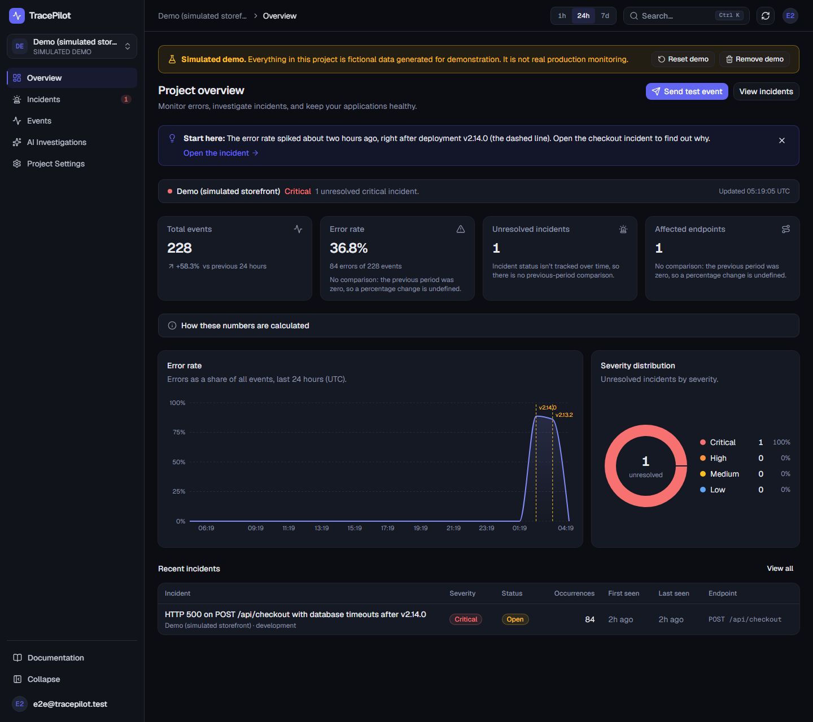 <br> **Dashboard** (24 h): error-rate spike between the v2.14.0 deploy and the rollback markers, KPIs with stated formulas, severity mix, recent incidents. | 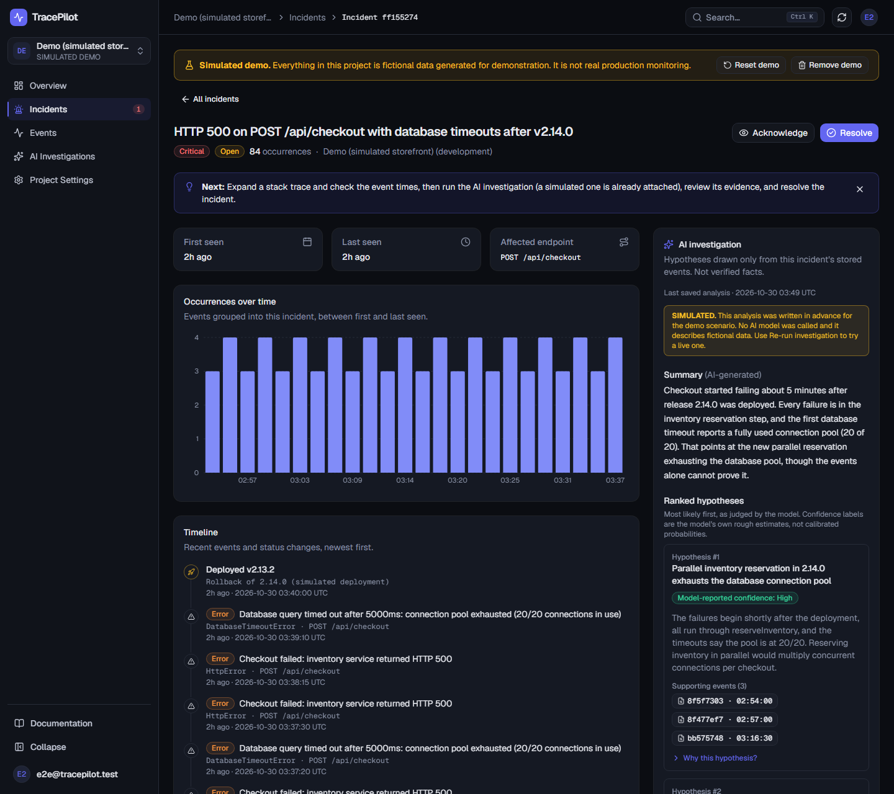 <br> **Incident detail**: occurrences chart, timeline with deployments, status actions, and the AI panel (summary, ranked hypotheses). |
| 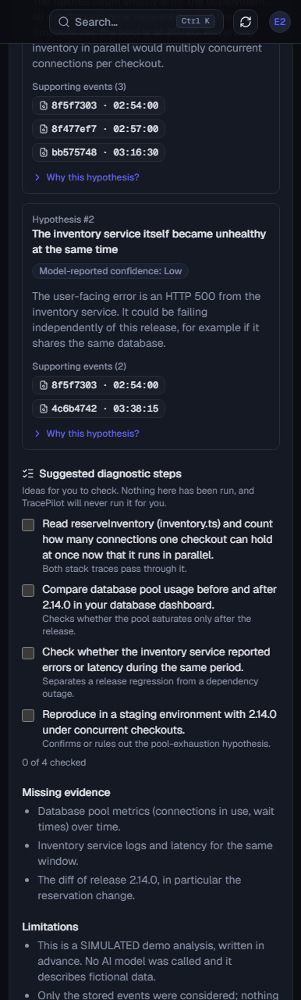 <br> **AI investigation**: model-reported confidence, evidence buttons, persisted checklist, missing evidence and limitations. | 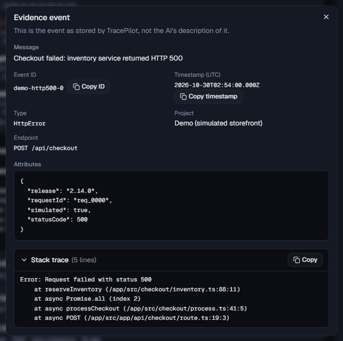 <br> **Evidence**: a citation opens the event exactly as stored, not the model's description of it. |
| 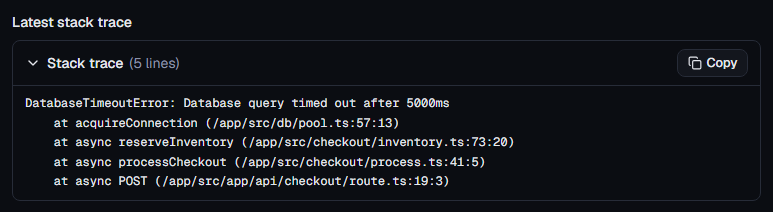 <br> **Stack trace** with copy. | 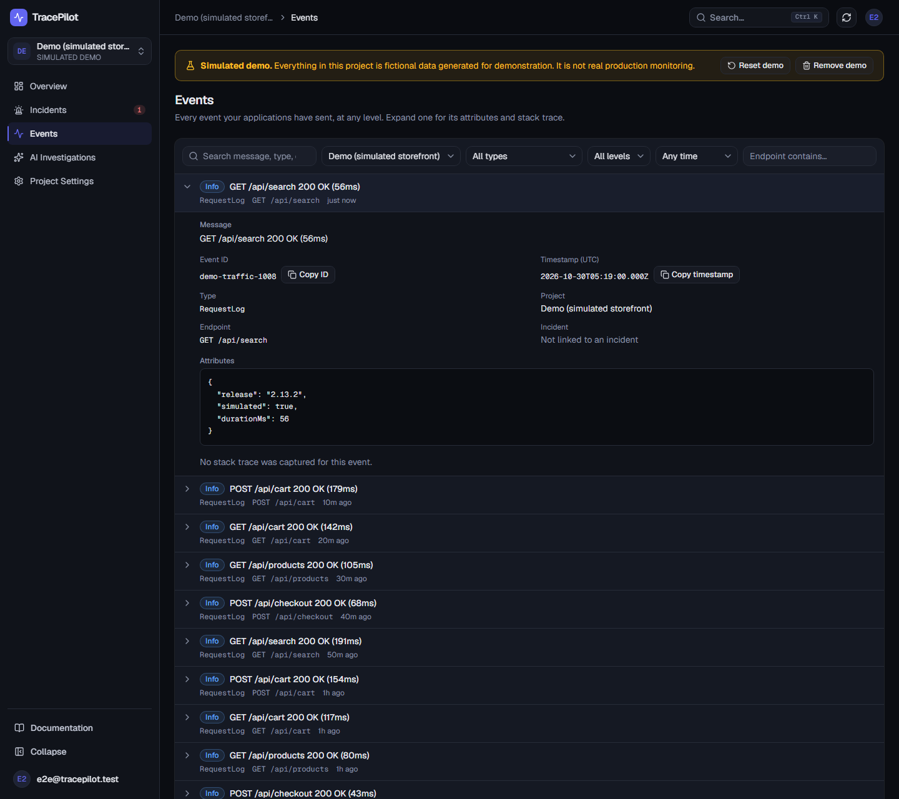 <br> **Events explorer**: search, filters, pagination, expandable rows. |
| 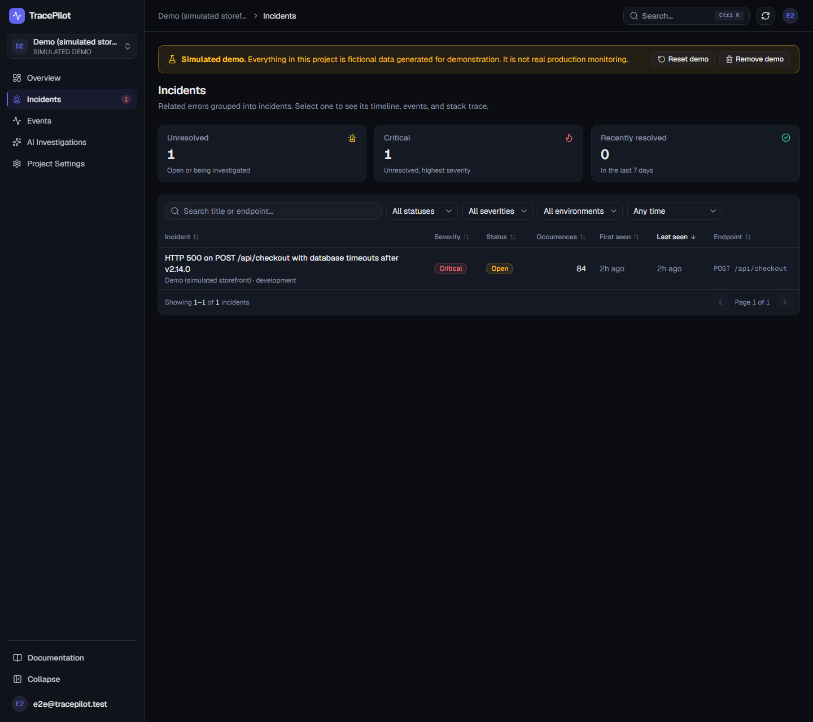 <br> **Incidents**: counters, filters, sortable columns, server-side pagination. | 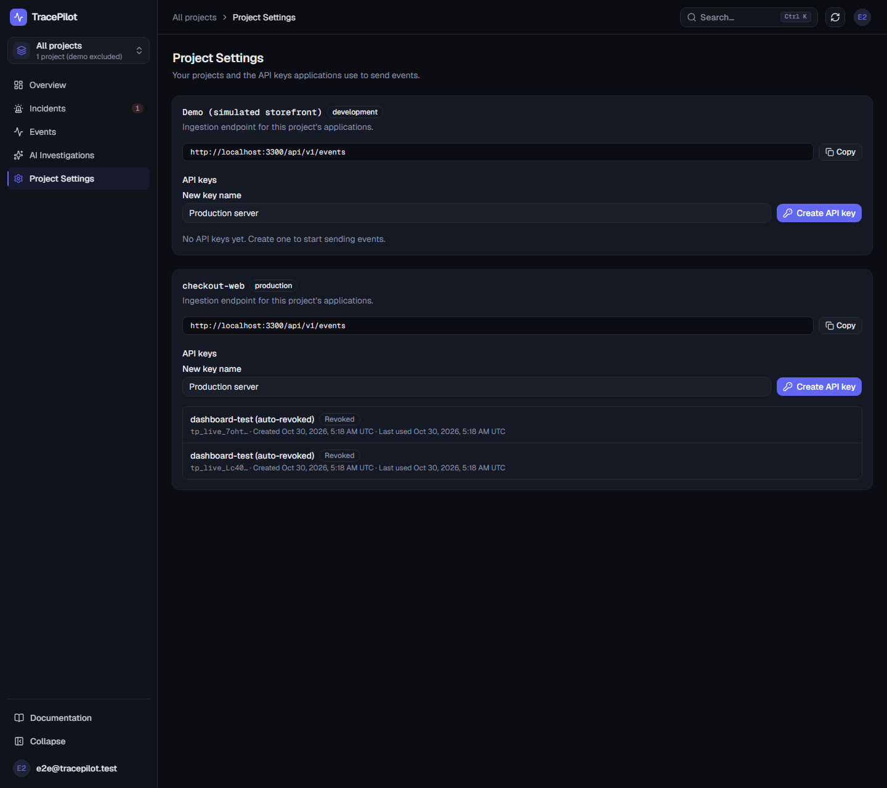 <br> **API keys**: shown once, hash-only storage, revocable. |
| 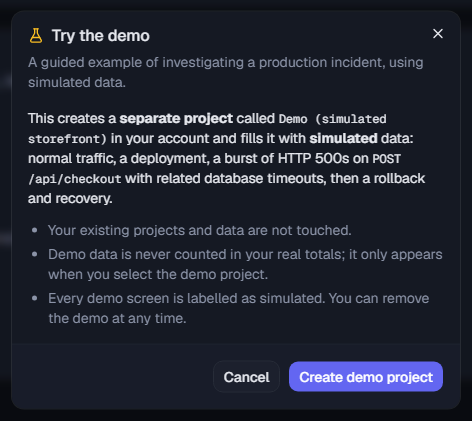 <br> **Try the demo** asks first and only ever creates a separate project. | 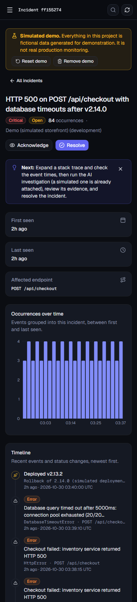 <br> **390 px**: the same incident on a phone. |

More: [7-day dashboard](docs/screenshots/dashboard-demo-7d-1440.png) · [dashboard with real (non-demo) data](docs/screenshots/dashboard-real-data-1440.png) ·
[mobile dashboard](docs/screenshots/dashboard-demo-390.png) · [mobile incidents](docs/screenshots/incidents-list-390.png) ·
[onboarding](docs/screenshots/onboarding-1440.png) · [landing](docs/screenshots/landing-1440.png) · [sign up](docs/screenshots/signup-1440.png)

## Architecture

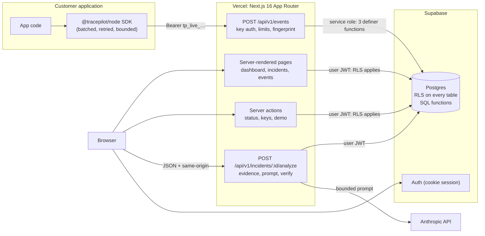

**Two trust levels, deliberately separate.**

| Path | Credential | Database access |
| --- | --- | --- |
| Ingestion (`/api/v1/events`) | Project API key (SHA-256 hashed at rest) | **Service role**, but only via three `SECURITY DEFINER` functions that take the project id from the key, never from the request |
| Everything a person does | Supabase session cookie → user JWT | **`authenticated` role**: every query is a `SECURITY INVOKER` function or table read, so Row Level Security enforces ownership in the database |

**Code layout.** Route handlers and pages are thin; logic lives in `src/lib/<domain>` behind small interfaces so it can be tested without a framework.

| Path | Responsibility |
| --- | --- |
| `src/app/**` | App Router pages, layouts, route handlers (`api/health`, `api/projects`, `api/v1/events`, `api/v1/incidents/[id]/analyze`) |
| `src/lib/ingest` | Validation (Zod), fingerprinting, key hashing, `handleIngest` with an `IngestStore` interface |
| `src/lib/incidents` | Data layer over RPC (`RpcClient`), URL param parsing, status transitions, timeline, dashboard queries |
| `src/lib/dashboard` | Metric definitions and trend rules (single source of truth), health derivation, formatting |
| `src/lib/ai` | Evidence → prompt → provider call → verification → persistence (`investigateIncident`), HTTP handler |
| `src/lib/demo` | Scenario constants, idempotent seeding service and actions |
| `src/components/**` | UI by feature (dashboard, incidents, events, demo, layout), shadcn/ui primitives in `ui/` |
| `supabase/migrations` | Seven ordered SQL files: the schema, RLS, grants and all SQL functions |
| `sdk/` | Zero-dependency Node.js client |
| `tests/` | Integration (real Postgres), e2e (Playwright), the local Supabase emulator, live RLS check |

## Technology stack

| Layer | Choice | Why |
| --- | --- | --- |
| Framework | Next.js 16 (App Router), React 19, TypeScript strict | Server components for data pages, route handlers for APIs, one deployable unit on Vercel |
| UI | Tailwind v4 tokens, shadcn/ui on Base UI, Recharts, Lucide | Accessible primitives, consistent tokens, small charts |
| Data | Supabase Postgres + Auth, `@supabase/ssr` | RLS gives per-user isolation in the database; managed auth |
| Validation | Zod 4 | One schema language for ingestion, URL params, AI output |
| AI | `@anthropic-ai/sdk`, server-side only | Key never reaches the browser; bounded prompt, schema-validated output |
| Tests | Vitest + Testing Library, embedded Postgres 17, Playwright | Real SQL under test; browser tests on a production build |
| Deploy | Vercel (no workers, no cron, no local files) | State lives in Postgres or cookies |

## Local setup

```bash
npm install
cp .env.example .env.local   # then fill it in (see the reference below)
npm run dev                  # http://localhost:3000
```

1. Create a Supabase project and apply the migrations ([Database](#database-migrations-and-seed)).
2. In Supabase: **Authentication → Email**: keep *Confirm email* on; **URL Configuration**: Site URL `http://localhost:3000`, redirect `http://localhost:3000/**`.
3. Fill `.env.local` with the Supabase URL, publishable key and service-role key. `ANTHROPIC_API_KEY` is optional: without it everything works and AI analysis shows a clear setup message.
4. Sign up, confirm the email, create a project, then **Try the demo** or **Send test event**.

### Environment variable reference

Defined in [`.env.example`](.env.example); validated lazily in `src/lib/env.ts` so the app builds and boots before any are set (pages then show a setup screen).

| Variable | Scope | Required | Purpose |
| --- | --- | --- | --- |
| `NEXT_PUBLIC_SUPABASE_URL` | public | yes | Supabase project URL |
| `NEXT_PUBLIC_SUPABASE_PUBLISHABLE_KEY` | public | yes | Publishable (browser-safe) key; legacy name `NEXT_PUBLIC_SUPABASE_ANON_KEY` also accepted |
| `SUPABASE_SERVICE_ROLE_KEY` | **server secret** | for ingestion | Bypasses RLS; used only by `POST /api/v1/events`. Missing → ingestion answers 503, rest of app works |
| `NEXT_PUBLIC_SITE_URL` | public | Production | Public origin for auth emails and the ingestion URL. On Vercel Preview leave unset: `VERCEL_URL` is used |
| `ANTHROPIC_API_KEY` | **server secret** | optional | Enables live AI analysis; absent → clear "not configured" message, demo and sample unaffected |
| `ANTHROPIC_MODEL` | server | optional | Default `claude-sonnet-5-5` |
| `AI_TIMEOUT_MS` | server | optional | Provider call ceiling, default 30000, clamped 1000–55000 |
| `VERCEL_ENV`, `VERCEL_URL`, `VERCEL_PROJECT_PRODUCTION_URL` | provided by Vercel | — | Used to pick the site URL |

### Database: migrations and seed

The schema is plain SQL in [`supabase/migrations/`](supabase/migrations) (seven files, applied once, in filename order). **The app never runs migrations.**

| File | Adds |
| --- | --- |
| `20261029000000_initial_schema.sql` | projects, api_keys, incidents, events, analyses + RLS |
| `20261029100000_project_onboarding.sql` | idempotent project creation, column grants |
| `20261029200000_event_ingestion.sql` | `incident_events`, `rate_limits`, the three ingestion functions, key privileges |
| `20261030000000_incident_views.sql` | invoker query functions, status guard trigger, activity log |
| `20261031000000_ai_investigation.sql` | analysis lifecycle, evidence selection, cost guard |
| `20261101000000_dashboard_and_demo.sql` | deployments, dashboard aggregation, demo seeder |
| `20261102000000_harden_analyses.sql` | analyses read-only for users; ownership-checked definer functions |

Apply them in the Supabase SQL editor (`npm run db:bundle` writes one pasteable file) or with the Supabase CLI, then run
[`supabase/verify.sql`](supabase/verify.sql): every row must say `ok = true`. Exact dashboard steps: [Deploy to Vercel](#deploy-to-vercel).

**Seed data.** There is no seed file to run. Sample data is created on demand by the signed-in user: **Try the demo** calls the
`seed_demo_project` function, which creates one *separate*, flagged, simulated project (1,092 events, 1 incident, 2 deployments, a pre-written
analysis), idempotently and deterministically. It never touches real projects, and the dashboard excludes it from "All projects" totals.

### Local end-to-end run (no accounts needed)

`npm run test:e2e:local` builds the app, starts it against `tests/emulator/serve.mts` (a **local Supabase emulator**: real embedded Postgres 17
with every migration applied, behind a small GoTrue/PostgREST-shaped HTTP server, plus a deterministic stub standing in for the Anthropic API)
and runs the whole Playwright suite signed in, including the critical flow and the demo walkthrough. It is **not Supabase**: it does not cover
email delivery, OAuth, pooling, or real latency. `KEEP=1 npm run test:e2e:local -- smoke` leaves the stack running (`:3300`) for manual use
and for `node scripts/capture-docs.mjs`, which regenerates the screenshots above.

## Event ingestion API

`POST /api/v1/events` — authenticated by a **project API key**, never by a user session.

Create keys in **Project Settings** (or onboarding step 3). The plaintext is shown **once**; only a SHA-256
hash is stored. Keys can be revoked instantly. A key authenticates *only* this endpoint; it is ignored by every
dashboard API, and browser session cookies are ignored here.

```
POST /api/v1/events
Authorization: Bearer tp_live_<43 chars>
Content-Type: application/json
```

Body: either **one event** or `{ "events": [ ... ] }` with 1–50 events.

| Field | Type | Required | Notes |
| --- | --- | --- | --- |
| `external_event_id` | string | yes | Your unique id, 1–128 chars of `A-Za-z0-9._:-`. Unique per project: re-sending is a no-op (idempotent). |
| `message` | string | yes | 1–4000 chars. |
| `occurred_at` | string | yes | ISO 8601 **with timezone**. Not more than 5 min in the future, not older than 30 days. |
| `event_type` | string | no | ≤100 chars, default `"error"` (e.g. the error class name). |
| `level` | enum | no | `debug` `info` `warning` `error` `fatal`; default `error`. |
| `endpoint` | string | no | ≤300 chars. The route/operation that failed. |
| `stack_trace` | string | no | ≤20 000 chars. V8-style stacks are used for grouping. |
| `attributes` | object | no | JSON, ≤16 KiB, ≤5 levels deep, ≤100 keys. |
| `fingerprint` | string | no | Custom grouping key; events sharing it share an incident. |

Unknown fields (including any `project_id`) are ignored: the project always comes from the key.
Validation is all-or-nothing: if any event in a batch is invalid, nothing is stored.

**Responses**

| Status | Meaning |
| --- | --- |
| `201` | At least one new event stored. |
| `200` | Every event was a duplicate (safe retry). |
| `400` | Body is not valid JSON/UTF-8. |
| `401` | Missing, malformed, unknown or revoked key (same response for all, with `WWW-Authenticate: Bearer`). |
| `413` | Body > 256 KiB, or more than 50 events. |
| `415` | `Content-Type` is not `application/json`. |
| `422` | Schema violation. `error.issues[]` lists `{ path, message }`, e.g. `events[2].occurred_at`. |
| `429` | Rate limited; honour `Retry-After`. 600 events/min per key; 30 failed auth attempts/min per client. |
| `500` | Server error; nothing was stored, safe to retry. |
| `503` | Ingestion is not configured on this deployment. |

```jsonc
// 201
{ "accepted": 1, "duplicates": 0,
  "results": [{ "external_event_id": "evt_1", "status": "accepted",
                "incident_id": "…uuid…", "occurrence_count": 3 }] }
// error
{ "error": { "code": "validation_failed", "message": "…", "issues": [{ "path": "events[1].level", "message": "…" }] } }
```

**Grouping.** Each event gets a deterministic 32-hex fingerprint: `event_type` + the message with ids, numbers
and quoted values normalised + the top three application stack frames (function@file, **no line numbers**, library
frames skipped). Without a usable stack, the normalised endpoint is used instead. Events with the same fingerprint
in a project become one incident (`unique(project_id, fingerprint)`); the incident tracks `occurrence_count`,
`first_seen_at`, `last_seen_at`, and the highest severity seen (`fatal`→critical, `error`→high, `warning`→medium,
else low). A resolved incident that recurs is reopened.

**Consistency.** A batch is processed by one Postgres function in a single transaction (`ingest_events`): either
every event is stored and linked to its incident, or none is. Incident rows are locked in fingerprint order, so
concurrent batches cannot deadlock, and counts are exact under concurrency (verified with parallel connections).

## Node.js SDK (`sdk/`)

Zero dependencies, Node ≥ 18.17. Not published to npm: install from the repo, `npm install ./path/to/tracepilot/sdk`
(it builds on install).

```ts
import { TracePilot } from "@tracepilot/node";

const tracepilot = new TracePilot({
  apiKey: process.env.TRACEPILOT_API_KEY,
  endpoint: process.env.TRACEPILOT_ENDPOINT, // base URL or the full /api/v1/events URL
  environment: "production",
});

try {
  await chargeCustomer();
} catch (error) {
  tracepilot.captureError(error, { endpoint: "/api/checkout", attributes: { orderId } });
  throw error;
}

tracepilot.captureMessage("cache warmed", { level: "info" });
await tracepilot.close(); // flush on shutdown (bounded by a timeout, never throws)
```

Options: `flushIntervalMs` (2000), `maxBatchSize` (20, max 50), `maxQueueSize` (100), `timeoutMs` (5000),
`maxRetries` (2), `onError`, `enabled`, `fetch`. `captureError` accepts `endpoint`, `level`, `attributes`,
`environment`, `eventId`, `fingerprint`, `timestamp`.

Guarantees: `capture*` never throws and never awaits the network · memory is bounded (overflow drops events and
reports via `onError`) · every request has a timeout; `flush()`/`close()` have an overall deadline and always
resolve · 429/5xx/network failures are retried with backoff (safe, because event ids make delivery idempotent) ·
timers are unref'd so the SDK never keeps your process alive · events are sanitised (size limits, NUL bytes,
circular/BigInt attributes) so one bad event can never get a whole batch rejected · missing key/endpoint turns the
client into a no-op rather than an error.

Limitations: best-effort, in-memory queue only. A hard crash loses queued events. Serverless runtimes must
`await close()` (or `flush()`) before returning. Node only (it uses `node:crypto`).

## Incidents, events, and the dashboard

All three screens read real data through one server-side layer (`src/lib/incidents/queries.ts`). Every query is
a `SECURITY INVOKER` Postgres function called as the signed-in user, so **Row Level Security enforces project
ownership on every read and write**; someone else's incident is indistinguishable from a missing one (404).
Values reach SQL only as bound parameters; the sort column is a whitelist inside the function, and `LIKE`
wildcards in search text are escaped.

| Route | What it does |
| --- | --- |
| `/incidents` | Unresolved / critical / recently resolved counters; search; filters for status, severity, environment, last-seen window; sortable columns; server-side pagination (20/page); empty, no-results, loading and error states. All state is in the URL (`q`, `status`, `severity`, `env`, `since`, `sort`, `dir`, `page`, `project`), so refresh, back, and shared links work. |
| `/incidents/[incidentId]` | Header with severity/status/occurrence count; **Acknowledge / Resolve / Reopen**; first/last seen and endpoint; occurrences chart; timeline of events and status changes; expandable stack trace with copy; paginated related events; AI investigation panel. |
| `/events` | Searchable, paginated event explorer with filters for project, type, level, endpoint, and time. Rows expand lazily to show the message, attributes, stack trace, linked incident, and copy-ID / copy-timestamp controls. |
| `/dashboard` | Four KPIs, an error-rate chart, severity distribution and recent incidents for 1 hour / 24 hours / 7 days, all aggregated in SQL (`dashboard_overview`). Every section has its own loading, empty and error state, and a failing section never blanks the page. Definitions are in [Dashboard metrics](#dashboard-metrics). |

The project selector has an **All projects** scope (the default). Route parameters are validated (a non-UUID is a
404 before any query); invalid query parameters fall back to defaults instead of erroring.

**Status transitions** are `open → investigating | resolved`, `investigating → resolved`, `resolved → open`. They are
checked in the UI, in the server action, and again by a database trigger that also stamps `resolved_at` and writes an
activity row (who, from, to). Changes use optimistic concurrency (`expected` status): if someone else changed the
incident first you get a conflict and the latest state, never a silent overwrite. A resolved incident that recurs is
reopened automatically and logged as a system action. The UI is deliberately not optimistic: it shows a pending
state and refreshes from the confirmed result, so there is nothing to roll back.

## Dashboard metrics

Formulas live in code (`src/lib/dashboard/metrics.ts`, rendered in the app under "How these numbers are calculated") and in the SQL
function `dashboard_overview`; integration tests assert the two agree and that every KPI equals the list it links to.

| Metric | Formula |
| --- | --- |
| Total events | `count(events with occurred_at in [from, to))`, any level |
| Error rate | `error + fatal events ÷ all events` in the window. **No events means no value, never 0%** |
| Unresolved incidents | `count(incidents where status ≠ resolved and last_seen in window)`. Equals `/incidents?status=unresolved&since=…` |
| Affected endpoints | `count(distinct endpoint)` among `error`/`fatal` events in the window (null endpoints ignored) |
| Severity distribution | the same unresolved incidents, grouped by severity |
| Error-rate chart | per bucket: errors ÷ events in that bucket. 12 buckets for 1 h, 24 for 24 h, 28 for 7 d. An empty bucket is a **gap**, not 0% |

**Time.** Everything is UTC and every window is half-open, `[from, to)`: an event at exactly `from` is in, an event at exactly `to` is out.
`to` is the moment the page rendered; `from` is `to` minus 1 hour / 24 hours / 7 days. Bucket edges use exact integer arithmetic
(a float rounding bug that put an on-the-edge event in the wrong bucket was found by a boundary test and fixed). Output is independent of
the database session time zone. Events, incidents, charts and lists all share the same window, so counts agree everywhere.

**Trends are only shown when they are real.** The comparison is the immediately preceding window of equal length. A trend is suppressed,
with the reason shown on the card, when (a) TracePilot has no event from before the start of the previous window (not enough history),
(b) the previous value is zero (a percentage of zero is undefined), (c) for rates, the previous window had fewer than 20 events, or
(d) the metric has no history (unresolved incidents are not snapshotted over time, so they never show a trend).

**Performance.** One round trip per section, aggregated in SQL (no row transfer). Indexes: `events(project_id, occurred_at)`,
`events(project_id, level, occurred_at)`, `incidents(project_id, status, last_seen_at)`, `deployments(project_id, deployed_at)`.
Lists are paginated server-side. There is **no polling**: data refreshes on navigation, on changing the range, or with the refresh button.

## Try the demo

For interviews, and for anyone who wants to see the product without wiring up an app. It is **simulated data, clearly labelled as such**,
and cannot be mistaken for production monitoring: a non-dismissible "Simulated demo" banner is shown whenever the demo project is
selected, event attributes say `simulated`, and the attached AI analysis is marked SIMULATED.

**Consent and isolation.** Nothing is created until you click **Create demo project** in a consent dialog. The demo is always a *new,
separate* project owned by you (`is_demo`, at most one per user); it never writes into your real projects or anyone else's, it is
excluded from "All projects" totals, and it is created by a dedicated function (`seed_demo_project`), not through event ingestion. The
`is_demo` flag cannot be set by clients. **Reset demo** rebuilds it; **Remove demo** deletes it.

**The story** (all times relative to the moment you create it, A):

```
A-7d ... A      steady, healthy traffic: one request log every 10 minutes
A-150m          deploy v2.14.0 ("reserve inventory in parallel")
A-145m..A-100m  60 x HTTP 500 + 24 x database timeouts on POST /api/checkout   -> ONE incident, 84 events
A-99m           rollback to v2.13.2; errors stop; recovery
A-90m           a pre-written, labelled-simulated investigation is attached
```

It is deterministic and idempotent: ids are derived from the project id, so seeding twice (or concurrently) yields the same single project
and data; the integration tests assert exact counts (1,092 events, 84 incident events, 2 deployments, 1 incident), identical relative
timelines for different users, and that other users' data is untouched.

**Walkthrough** (about two minutes):

1. Open the dashboard and choose **Try the demo** (sidebar project menu, empty state, or command menu), then **Create demo project**.
2. On **Last 24 hours** the error-rate chart spikes (peak above 50%) between two dashed lines marking the v2.14.0 deploy and the rollback,
   then returns to 0%. KPIs read 228 events, 36.8% error rate (84 errors of 228), 1 unresolved incident, 1 affected endpoint. Events shows a
   real +58% trend; the error-rate trend is correctly suppressed (previous period was 0%), and on 7 days no trend is shown at all.
3. Click the critical incident, **HTTP 500 on POST /api/checkout** (the small dismissible hint points here).
4. The timeline shows the deploy, the first error, and the rollback. Expand a stack trace (`reserveInventory`, pool timeout) and page through
   the 84 events (10 per page).
5. The pre-written investigation is already attached and labelled SIMULATED. **Re-run investigation** performs a real one if
   `ANTHROPIC_API_KEY` is set; the deployment records are passed to the model as context.
6. Open any cited evidence event: every citation is a real stored event of this incident. Tick checklist steps (they persist).
7. **Resolve** the incident: unresolved drops to 0 and "recently resolved" to 1, while the error events remain in the data.

**Screenshots.** See [Screenshots](#screenshots) at the top. `tests/e2e/demo-walkthrough.spec.ts` drives steps 1-7 in Chromium (it creates and then removes the signed-in user's demo project, so use a throwaway account against a real deployment) and `npm run test:e2e:local` runs it against the local emulator with no accounts.

## AI investigation

`POST /api/v1/incidents/[incidentId]/analyze` asks a Claude model to propose root-cause hypotheses for one
incident **using only the events already stored in TracePilot**. It is session-authenticated (an ingestion API key
is ignored), the Anthropic key never leaves the server, and nothing runs after the response returns.

### Setup

1. Apply all seven migrations (the last one is `20261102000000_harden_analyses.sql`).
2. Set the server-only variables in `.env.local` and Vercel:

| Variable | Default | Meaning |
| --- | --- | --- |
| `ANTHROPIC_API_KEY` | _(unset)_ | Required. Without it the endpoint returns `503 ai_not_configured` and the UI says so. |
| `ANTHROPIC_MODEL` | `claude-sonnet-5-5` | Any model id the Anthropic API accepts. An unknown id returns a clear `model_unavailable` error. |
| `AI_TIMEOUT_MS` | `30000` | Hard ceiling for the provider call, clamped to 1000-55000 so it fits the route's `maxDuration = 60`. |

### What happens on a request

1. Authenticate the user and check the request is same-origin JSON (it is cookie-authenticated and costs money, so cross-site and form posts are rejected).
2. Fetch the incident through Row Level Security. Someone else's incident is a 404, indistinguishable from a missing one.
3. Claim the analysis slot. The database allows **one pending analysis per incident** (concurrent clicks get `409`) and **20 analyses per user per hour** (`429`).
4. Select evidence in SQL (`select_evidence_events`): the 6 newest events, the first-seen event, and one example per distinct message/stack shape (numbers normalised), at most about 11 events with full detail.
5. Build the prompt from those events only. Each field is length-capped and the whole prompt is capped at 28,000 characters, dropping the oldest-listed events if needed. Event text is wrapped in tags and labelled untrusted data.
6. Call Anthropic server-side with a hard timeout and **no retries** (a retry would double the cost and the wait).
7. Validate the reply with Zod, then **verify every cited event id is one of the events that were actually in the prompt**. A single unknown id rejects the whole analysis.
8. Persist status, model, token usage, timestamps and the validated output (`analyses`), and return it.

Recorded deployments (the `deployments` table; the demo has two) near the incident are included as context only: they are not events and cannot be cited. If none are recorded the prompt says so. The `release` and other attributes your events carry are included too.

### Response

`200 { analysis }` on success. On failure the body is `{ error: { code, message, retryable }, analysis? }`:

| Status | `code` | Retry? |
| --- | --- | --- |
| 401 / 403 / 404 / 415 | `unauthorized`, `forbidden`, `not_found`, `unsupported_media_type` | no |
| 409 | `analysis_in_progress` | yes, after the current one finishes |
| 429 | `analysis_rate_limited`, `rate_limited` (provider) | yes, after `Retry-After` |
| 503 | `ai_not_configured`, `auth`, `model_unavailable`, `provider_rejected` | no, fix configuration |
| 504 / 502 | `timeout`, `provider_unavailable`, `invalid_response`, `invalid_evidence` | yes |
| 422 | `refused`, `no_events` | no |

Every failure is also saved on the `analyses` row (`error_code`, `retryable`), so the UI shows it after a reload. An analysis
can never stay "in progress": the provider call is time-boxed, and a pending row older than 2 minutes is reported as
failed/retryable by the database even if the request that owned it was killed.

### What the model returns (and how the UI treats it)

An executive summary; 1-5 **ranked hypotheses** (first = model's most likely), each with a **model-reported confidence**
(`low`/`medium`/`high`), explanation, and **evidence citations** (event id + a one-sentence "why"); read-only
**recommended diagnostic steps**; **missing information**; **limitations**. The incident page shows the summary first, then
ranked cards; each citation opens the real stored event; "Why this hypothesis?" expands the per-event reasoning; steps are a
checklist whose ticks are saved. Everything the model wrote is labelled AI-generated and unverified.

### Limitations: read before trusting it

- **Hypotheses, not diagnoses.** The model sees at most about 11 events of an incident, not your code, deployments, infrastructure, or other logs. It can be wrong, miss the real cause, or over-read patterns in a small sample.
- **Confidence is the model's own rough label, not a calibrated probability.** It is not measured against outcomes; the UI says so and never shows percentages.
- **Citations prove the events exist, not that they support the claim.** Verification catches invented event ids; it cannot check the reasoning. Open the evidence and judge it.
- **Nothing is verified, run, or fixed.** TracePilot never executes AI-suggested code or commands. The prompt forbids destructive suggestions, but a model can still suggest something unwise: review every step.
- **Event content is untrusted input.** It is isolated and labelled in the prompt, but prompt injection through log text is a known risk for any LLM pipeline; the output schema and citation check limit, not eliminate, its effect. Do not send secrets in events.
- **Your event text is sent to Anthropic** when you run an investigation. Review Anthropic's data-handling terms before enabling it on sensitive systems.
- Output can vary between runs, and a model, key, or rate-limit problem makes the feature unavailable (the rest of TracePilot is unaffected).

### Cost

You pay Anthropic per token (see their pricing page; the figures below are my estimates from list prices as of October 2026, which may change):

| Model (`ANTHROPIC_MODEL`) | Input / output per 1M tokens | Typical analysis* | Worst case* |
| --- | --- | --- | --- |
| `claude-haiku-5-5` | $0.10 / $0.50 | about $0.002 | about $0.005 |
| `claude-sonnet-5-5` (default) | $2 / $10 | about $0.04 | about $0.08 |
| `claude-opus-5-5` | $4 / $20 | about $0.08 | about $0.16 |

*A request sends about 7-10k input tokens (the 28,000-character prompt cap) and the answer is up to 6,000 output tokens, typically 1-3k including reasoning.
The exact input and output tokens of every analysis are stored in `analyses.usage` and shown on the card. Cost is bounded by the prompt cap, the
output cap, one analysis in flight per incident, and 20 analyses per user per hour (worst case about $1.60 per user-hour on the default model).
Re-running always costs again; viewing a saved analysis is free.

### Sample investigation

"View a sample investigation" shows a fixed, fictional analysis built from seeded sample logs (`src/lib/ai/sample.ts`). It runs
through the same validation and citation checks as a real one, calls no model, and is labelled SAMPLE throughout. It is deterministic and
is not a diagnosis of anything real. The live action always calls the configured provider and reports missing credentials plainly.

## Security model

- Project keys: 256-bit CSPRNG, hash-only storage, shown once, revocable, ≤10 active per project. The hash column
  is not readable by signed-in users (column-level grants).
- Ingestion uses the **service-role** key on the server only (`server-only` import; never in a client bundle),
  and only through three `SECURITY DEFINER` functions that only `service_role` may execute.
- Row Level Security on every table; signed-in users can read their own events/incidents but cannot write them.
- Rate limits live in Postgres (serverless has no shared memory); no Redis or workers.
- The dashboard "Send test event" submits through the real HTTP API using a short-lived key that is revoked
  immediately after.
- Secrets are never logged; error responses never echo input or internals.
- AI analyses are **read-only for users** (all writes go through three ownership-checked functions), so the 20/hour cost guard
  cannot be bypassed by editing or deleting rows. Untrusted log text is HTML-escaped before it enters the AI prompt, and every
  citation is verified against the retrieved events.
- Cookie-authenticated mutations (`/api/projects`, the analyze endpoint) reject cross-site requests; no CORS headers are sent.
  Every response carries `nosniff`, `X-Frame-Options: DENY`, a restrictive Referrer-Policy and a minimal CSP (`frame-ancestors 'none'`).
- Open redirects: `?next=` accepts only same-origin relative paths. Event text and attributes are rendered as React text, never as HTML.

## Testing and commands

| Command | What it runs | Last result (this repo, local) |
| --- | --- | --- |
| `npm run lint` · `npm run typecheck` · `npm run build` | ESLint, `tsc --noEmit`, production build | see [PROJECT_STATUS.md](PROJECT_STATUS.md) |
| `npm test` | Vitest unit and component tests (metric formulas, validation, fingerprinting, status transitions, AI verification with a mocked provider, UI states) | see status |
| `npm run test:integration` | **Real Postgres 17** (embedded; no Docker or Supabase account): every migration, RLS and grants as real roles, ingestion handler → SQL, incident grouping under concurrency, authorization, the AI pipeline with a mocked provider, the demo, dashboard metrics, `supabase/verify.sql`, real server pages rendered against real data | see status |
| `npm run test:e2e` | Playwright against a production build it starts: public pages, headers, redirects, signed-out protection, ingestion/AI endpoint security, layout at 1440/1024/390 px. Signed-in specs skip without credentials | see status |
| `npm run test:e2e:local` | The **same suite, signed in**, against the local emulator (see above): critical flow, demo walkthrough, dashboard, status transitions | see status |
| `npm run test:rls` | Opt-in: RLS checks against **your** Supabase project (creates and deletes two throwaway users) | not run |
| `node scripts/bench-ingest.mjs` | Repeatable ingestion load test over HTTP (below) | see below |
| `npm run db:bundle` | Writes all migrations into one pasteable SQL file | — |

**The critical flow** is covered twice: without a browser in `tests/integration/critical-flow.test.ts` (real handlers, real Postgres, mocked provider) and
in a browser in `tests/e2e/critical-flow.spec.ts` (sign in → select project → send test event → events list → incident → AI investigation → evidence opens the
stored event → resolve → reload and confirm persistence). Failure cases covered: invalid and oversized payloads, repeated submissions, revoked/unknown keys,
database failure, other users' incidents, missing AI configuration, provider timeout, malformed AI output, fabricated citations, double-click.

### Ingestion benchmark

`scripts/bench-ingest.mjs` sends real HTTP requests to `POST /api/v1/events`, spread over 5 distinct error shapes and 10 API keys (to stay under the 600 events/min per-key limit),
then reports client-observed latency percentiles. Numbers below are from one run each on the date in PROJECT_STATUS.md; **they characterise this setup, not Vercel or Supabase.**

**Environment.** Windows 11, AMD Ryzen 5 5600H (12 logical cores), 15 GB RAM, Node 24. Everything on one machine: the load generator, `next start` (production build),
the local Supabase emulator (each ingest request makes three HTTP calls to it: authenticate key, rate limit, ingest), and an embedded Postgres 17. No network latency, no TLS, no cold starts.

| Workload | Requests | Concurrency | Throughput | p50 | p90 | p95 | p99 | max | Errors |
| --- | --: | --: | --: | --: | --: | --: | --: | --: | --: |
| 3,000 events, 1 per request | 3,000 | 16 | 231 req/s (231 events/s) | 65 ms | 90 ms | 103 ms | 129 ms | 402 ms | 0 % (all 201) |
| 3,000 events, 10 per request | 300 | 16 | 175 req/s (1,746 events/s) | 79 ms | 125 ms | 154 ms | 316 ms | 412 ms | 0 % (all 201) |

**Correctness under that load** (checked in the database afterwards, not just from responses): the 6,000 events produced exactly **5 incidents with 1,200 occurrences each**,
i.e. no lost or double-counted updates with 16 concurrent writers hitting the same five fingerprints.

What this does not show: behaviour on Vercel (cold starts, regional latency), Supabase's pooler and network, sustained load beyond a few seconds, or the cost of large `events` tables.

## Deploy to Vercel

TracePilot is a plain Next.js 16 App Router app. It deploys with Vercel's standard Next.js build (`next build`, no `vercel.json`, no custom
output) and has **no persistent server, local file storage, background worker or cron job**:

| Concern | How it works |
| --- | --- |
| Database | Supabase Postgres, reached over HTTPS through supabase-js (PostgREST). There is **no `DATABASE_URL`**, no TCP connection and no pool to configure; Supabase pools connections on its side, so serverless cold starts and concurrency are fine. |
| Migrations | SQL files you apply once (below). **The app never runs migrations**, on a request or at build time; if one is missing it shows a "Database setup required" screen. |
| State | Everything (sessions, rate limits, one-analysis-at-a-time, idempotency) lives in Postgres or cookies. Nothing is kept in memory between requests. |
| Function duration | Only `POST /api/v1/incidents/[id]/analyze` sets `maxDuration = 60` (one Anthropic call, hard-capped by `AI_TIMEOUT_MS`, max 55 s). Everything else uses Vercel's default. |
| Scheduled work | None. There is deliberately no cron job (`vercel.json` does not exist). |
| Secrets | `SUPABASE_SERVICE_ROLE_KEY` and `ANTHROPIC_API_KEY` are read only in server code (`server-only` modules and route handlers). Only `NEXT_PUBLIC_*` values reach the browser. |

> **Plan limits.** The analyze route asks for 60 s. Vercel's maximum function duration depends on your plan and on whether Fluid Compute is
> enabled; **check your project's limit under Settings → Functions** (I could not check your account). If it is lower than 60 s, edit `maxDuration`
> in `src/app/api/v1/incidents/[incidentId]/analyze/route.ts` and set `AI_TIMEOUT_MS` at least 5 s below it, otherwise the deploy may be rejected or analyses will time out.
> Dashboard menu names below follow the current Vercel and Supabase UIs and may differ slightly.

### Environment variables

Add these in Vercel under **Project → Settings → Environment Variables** (see [`.env.example`](.env.example) for the annotated list).
Mark the two secrets **Sensitive**. `NEXT_PUBLIC_*` values are baked in at build time, so **changing one requires a redeploy**.

| Variable | Production | Preview | Secret | Required | Notes |
| --- | :-: | :-: | :-: | :-: | --- |
| `NEXT_PUBLIC_SUPABASE_URL` | ✔ | ✔ | no | **yes** | Supabase "Project URL" |
| `NEXT_PUBLIC_SUPABASE_PUBLISHABLE_KEY` | ✔ | ✔ | no | **yes** | `sb_publishable_…`. Legacy projects may use `NEXT_PUBLIC_SUPABASE_ANON_KEY` (the "anon" JWT) instead; either name works |
| `SUPABASE_SERVICE_ROLE_KEY` | ✔ | ✔ | **yes** | for ingestion | `sb_secret_…` / service_role. Without it `POST /api/v1/events` answers 503; the rest of the app works |
| `NEXT_PUBLIC_SITE_URL` | ✔ | **leave unset** | no | Production | Your production origin, no trailing slash. In Preview the app uses Vercel's per-deployment `VERCEL_URL`, so auth emails link back to that preview. Setting this for Preview makes preview emails point at production |
| `ANTHROPIC_API_KEY` | optional | optional | **yes** | no | Absent: demo, sample and everything else work, and "Investigate with AI" shows a "not configured" message |
| `ANTHROPIC_MODEL` | optional | optional | no | no | default `claude-sonnet-5-5` |
| `AI_TIMEOUT_MS` | optional | optional | no | no | default 30000, clamped to 1000–55000 |

`VERCEL_ENV`, `VERCEL_URL` and `VERCEL_PROJECT_PRODUCTION_URL` are provided by Vercel. Use separate Supabase projects for Production and Preview
if previews should not touch real data (the variables above can differ per environment).

### Step by step

**1. Create the Supabase project** (supabase.com/dashboard)
1. **New project** → pick the organization, a name, a **region** (choose one near where your Vercel functions will run), and a strong database
   password (store it in a password manager; the app does not use it). **Create new project** and wait until it is healthy.
2. **Project Settings → API Keys**: copy the **Project URL**, the **publishable** key, and (click Reveal) the **secret** key. If the page shows
   the legacy tab instead, use the `anon` key for the publishable value and `service_role` for the secret.
3. **Authentication → Sign In / Providers → Email**: enable it and keep **Confirm email** ON (the app requires a verified address).

**2. Apply the migrations** (once, in order; they are not idempotent)
1. Run `npm run db:bundle`. It writes `supabase/all-migrations.generated.sql`, the seven files in `supabase/migrations/` concatenated in order.
2. Supabase dashboard → **SQL Editor → New query** → paste the whole generated file → **Run**. It must finish without error.
   (Alternative: paste the seven files one by one in filename order. Do not run any twice.)
3. New query → paste [`supabase/verify.sql`](supabase/verify.sql) → **Run**. **Every row must show `ok = true`.** A `false` row names what is missing;
   the most common cause is a skipped migration, and the app shows "Database setup required" until it is applied.
4. *CLI alternative:* `npx supabase init`, `npx supabase login`, `npx supabase link --project-ref <ref>`, `npx supabase db push`. (Not exercised here.)

**3. Configure authentication URLs** (Supabase → **Authentication → URL Configuration**)
1. **Site URL**: your production URL, e.g. `https://tracepilot.vercel.app` (you can set a placeholder now and correct it after step 6).
2. **Redirect URLs**, add all of:
   - `https://<your-production-domain>/**`
   - `https://*-<your-vercel-team-or-account-slug>.vercel.app/**` (so preview deployments can complete sign-up and password reset)
   - `http://localhost:3000/**` (local development)
3. Email links land on `/auth/callback`, which only accepts same-origin paths. Supabase's built-in email sender is heavily rate-limited
   (only a handful of messages per hour); configure **Authentication → SMTP Settings** before inviting real users.

**4. Connect the Git repository to Vercel**
1. The project is not yet a Git repository. In the project folder: `git init`, `git add .`, and **before committing check `git status`**: `.env.local`
   must not appear (it is gitignored; `.env.example` is meant to be committed). Then `git commit -m "Initial commit"`.
2. Create an empty repository on GitHub (or GitLab/Bitbucket), then `git remote add origin <url>` and `git push -u origin main`.
3. Vercel dashboard → **Add New… → Project** → **Import** the repository. Framework Preset is detected as **Next.js**; leave Build Command, Output
   Directory and Install Command at their defaults. Under **Settings → General**, Node.js Version 22.x (or any ≥ 20.9) is fine.
4. **Do not click Deploy yet**: add the environment variables first (step 5), or the first build runs without them.

**5. Add environment variables** (on the import screen, or **Settings → Environment Variables**)
1. For each row of the table above, enter the name and value and tick the environments (**Production**, **Preview**; leave Development unticked).
2. Mark `SUPABASE_SERVICE_ROLE_KEY` and `ANTHROPIC_API_KEY` as **Sensitive**.
3. Set `NEXT_PUBLIC_SITE_URL` for **Production only**. If you do not know the URL yet, deploy once, then add it and redeploy (step 6).

**6. Deploy**
1. Click **Deploy**. When it finishes, open the production URL and note it.
2. If `NEXT_PUBLIC_SITE_URL` was not set, add it now (your real production URL), then **Deployments → ⋯ → Redeploy** (untick "Use existing Build Cache").
   Also put this exact URL in Supabase's **Site URL** (step 3).
3. Optional: **Settings → Functions → Function Region**: choose the region closest to your Supabase project to cut query latency.

**7. Test the deployed URL**
1. **Health:** open `https://<your-url>/api/health`. Expect `{"status":"ok","supabaseConfigured":true,"ingestionConfigured":true,"aiConfigured":…}`.
   Any `false` means that variable is missing for this environment (or you did not redeploy after adding it). The endpoint returns only booleans.
2. **Login:** `/signup` → create an account → open the confirmation email → the link returns you signed in, and you are sent to onboarding.
   Create a project; sign out and sign back in at `/login`; try "Forgot password" once.
3. **Demo (no AI key needed):** on the dashboard choose **Try the demo → Create demo project**, then follow the walkthrough in [Try the demo](#try-the-demo).
4. **Ingestion:** in onboarding (or **Settings**) create an API key, copy it once, then:
   ```bash
   curl -i -X POST https://<your-url>/api/v1/events \
     -H "Authorization: Bearer tp_live_YOUR_KEY" -H "Content-Type: application/json" \
     -d '{"external_event_id":"deploy-check-1","level":"error","event_type":"TypeError","message":"deploy check","endpoint":"/api/test","occurred_at":"'"$(date -u +%Y-%m-%dT%H:%M:%SZ)"'"}'
   ```
   Expect `201` with `"accepted":1`; sending it again returns `200` with `"duplicates":1`. A wrong key returns `401`; a `503` means
   `SUPABASE_SERVICE_ROLE_KEY` is missing. The event and its incident then appear under **Events** and **Incidents**. The dashboard's **Send test event** does the same through this API.
5. **AI investigation:** open the incident → **Investigate with AI**.
   - Without `ANTHROPIC_API_KEY`: the panel says AI analysis is not configured and **View a sample investigation** still works (the API answers `503 ai_not_configured`).
   - With the key: you get a summary, ranked hypotheses and evidence buttons that open the real stored events. Check `analyses.usage` (token counts) in the Table Editor after the first run.
6. **Revoke test:** revoke the key in Settings and repeat the curl; it must return `401`.

> **Preview deployments** work with the variables above, with one caveat: Vercel's **Deployment Protection** (Vercel Authentication) blocks every
> unauthenticated request to a preview, including SDK ingestion and the dashboard's "Send test event" (which calls its own deployment over HTTP).
> Test ingestion on Production, or use Vercel's *Protection Bypass for Automation*.

### Deployment checklist

- [ ] Supabase project created; Email provider on with **Confirm email**; (for real use) custom SMTP configured
- [ ] All 7 migrations applied once, in order; `supabase/verify.sql` shows only `ok = true`
- [ ] Supabase **Site URL** = production URL; **Redirect URLs** include production `/**`, the preview wildcard and localhost
- [ ] Repository pushed (without `.env.local`) and imported into Vercel as a Next.js project
- [ ] Env vars set for Production **and** Preview: Supabase URL, publishable key, service-role key (Sensitive); `NEXT_PUBLIC_SITE_URL` for Production only
- [ ] `ANTHROPIC_API_KEY` set (Sensitive) if you want live AI; otherwise confirm the "not configured" message appears
- [ ] Deployed (or redeployed after adding variables); `/api/health` shows the expected booleans
- [ ] Signup → email confirmation → onboarding → login/logout work on the deployed URL
- [ ] Curl ingestion returns 201, then 200 duplicate; a revoked key returns 401; the event and incident appear
- [ ] Demo works with no AI key; AI investigation works or shows the setup message
- [ ] Supabase service-role key rotated if it was ever committed or pasted anywhere
- [ ] Function region chosen near Supabase; function logs reviewed once (Vercel → Logs)

### Troubleshooting

| Symptom | Cause / fix |
| --- | --- |
| Every page says "Supabase is not configured" | URL / publishable key missing **for this environment** or not redeployed after adding them |
| "Database setup required" | A migration is missing; run the bundle again on a fresh project, or apply the missing file(s), then `verify.sql` |
| Confirmation link goes to localhost or the wrong host | Supabase **Site URL** / **Redirect URLs** wrong, or `NEXT_PUBLIC_SITE_URL` set for Preview |
| `Invalid redirect` / link bounces to `/login?error=callback` | The redirect URL is not in the allow-list, or the link expired / was already used |
| Ingestion returns 503 | `SUPABASE_SERVICE_ROLE_KEY` missing for that environment |
| AI returns 504 / `timeout` | Provider slow; raise `AI_TIMEOUT_MS` (max 55000) within the plan's function limit and retry |
| Deploy fails on `maxDuration`, or analyses cut off | Your plan's function limit is below 60 s (see Plan limits) |

## Engineering trade-offs

- **SQL functions for the data layer.** Queries are `SECURITY INVOKER` Postgres functions called over RPC. Ownership is enforced by RLS in the database (a bug in app code cannot widen access) and the SQL is testable against a real Postgres. Cost: logic lives in migrations rather than TypeScript, and schema changes need a migration.
- **Postgres as the only state.** Rate limits, the one-analysis-at-a-time lock, idempotency keys and cost guards are table rows, not Redis or in-memory counters, because serverless instances share no memory. Cost: each ingest request does extra writes (rate-limit upsert).
- **Row-by-row ingest function.** A batch is processed by one plpgsql function in one transaction (atomic, deadlock-free via fingerprint ordering). It is simple and correct; it is not the fastest possible bulk path.
- **Fixed-window rate limiting.** Easy to reason about and cheap; allows a short burst at window boundaries (up to 2× the limit across a boundary).
- **Fingerprinting by normalised message + top stack frames.** Deterministic and explainable; it will split an incident when the message text changes materially and merge unrelated errors that share a generic message and no stack. Callers can supply their own `fingerprint`.
- **LLM output is untrusted.** Prompt text is escaped, output is schema-validated, and a single citation outside the retrieved set rejects the whole analysis. Cost: occasional rejected analyses (retryable) rather than a partially trustworthy answer. No provider retries (they would double cost and latency).
- **AI evidence is a sample, not the whole incident.** Newest 6 + first-seen + up to 4 representative shapes within a 28,000-character prompt cap keeps cost bounded and predictable.
- **No polling or realtime.** Pages refresh on navigation or the refresh button; simpler and cheaper, but the dashboard is not live.
- **Test emulator instead of a Supabase account.** It lets the signed-in app run in CI-like conditions, but it is an emulator; real Supabase is still unverified.

## Known limitations and future improvements

Limitations (more in [PROJECT_STATUS.md](PROJECT_STATUS.md)): not deployed or verified on real Supabase/Vercel/Anthropic; analysis content can be forged by its own owner via a
direct RPC call (verification is app-side); no per-user limits on project/key creation; no data retention; incident search is `ILIKE '%…%'`; no CSP `script-src`; single-user projects (no teams or roles).

Next steps, roughly in value order:
1. Deploy and verify against real Supabase and Anthropic; run `npm run test:rls` and the signed-in e2e there.
2. Write final analysis results with the service role after server-side verification, closing the self-forgery gap.
3. Per-user rate limits on creation endpoints; retention and quotas; partition `events` by time.
4. Trigram or full-text search; materialised rollups for the 7-day dashboard at volume.
5. Source maps / release tracking for richer deploy correlation; Slack or email notifications; analysis history and diffing; a published SDK package.
6. Optional realtime updates (Supabase Realtime) for the incident page.
